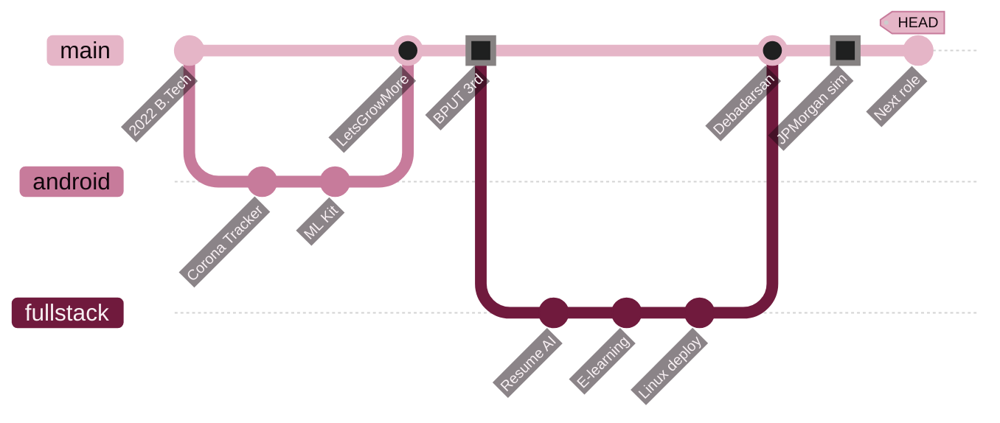
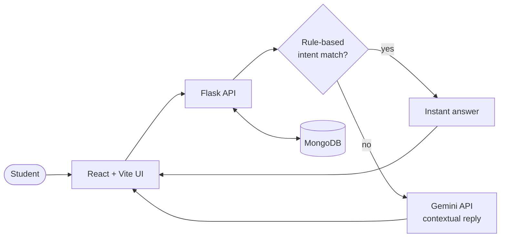
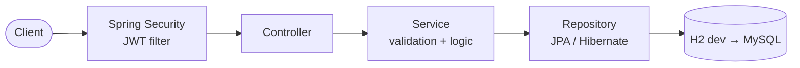

<div align="center">

<picture>
  <source media="(prefers-reduced-motion: reduce)" srcset="assets/hero-static.svg"/>
  
</picture>

<br/>

[](https://linkedin.com/in/ayushraj2313)
[](mailto:ayushrajj.231@gmail.com)
[](https://mine-portfolio-six-bay.vercel.app/)


</div>

## `$ cat about.md`

I build backends that don't fall over and AI features that do real work. Java + Spring Boot is home, React and FastAPI are the neighbours, and Gemini is the guest who got a job.

- 🎓 **B.Tech CSE '26**, Gandhi Engineering College, Bhubaneswar (CGPA 8.2)
- 🏗️ Two internships, two production-style full-stack apps shipped, one npm package in the wild
- 🏆 **3rd place, BPUT Hackathon 2024** (AI job-matching platform, 47 teams)
- 🎤 **Toastmasters Speech Contest winner 2024**, and I can explain a JWT to your non-technical manager
- 🔭 Now: backend engineering, system design, DSA grind, practical LLM products


## `$ git log --graph --oneline` &nbsp;·&nbsp; experience



<details>
<summary><b>🧑‍💻 Debadarsan Consulting</b> — Full-Stack Developer Intern · <i>May – Jul 2025</i></summary>
<br/>

- Delivered **2 full-stack apps** in an agile team, owning backend, frontend integration, testing and deployment.
- **AI Resume Analyzer** (FastAPI · React · MongoDB · Gemini API) automating resume evaluation, **~30% less manual effort**.
- **Role-based e-learning platform** (Spring Boot · React · MongoDB) with JWT authN/authZ across multiple user roles.
- Environment-based config management and deployments on **Linux servers**.

</details>

<details>
<summary><b>📱 LetsGrowMore</b> — Android Developer Intern · <i>Jun – Jul 2024</i></summary>
<br/>

- **Corona Tracker** app stitching multiple REST APIs into live stats for **195+ countries**.
- **Firebase ML Kit** face recognition with **on-device emotion detection**.

</details>

<details>
<summary><b>🏦 JPMorgan Chase & Co.</b> — Software Engineering Job Simulation (Forage) · <i>Jun 2026</i></summary>
<br/>

Project setup, **Kafka** integration, **H2** integration, REST API integration and REST controllers.

</details>


## `$ ls ~/projects` &nbsp;·&nbsp; things I shipped

<table>
<tr>
<td width="50%" valign="top">

### 🤖 DTE Bot
**AI college assistant that handles ~85% of routine student queries.**

`React` `Vite` `Flask` `MongoDB` `Gemini` `AWS`

Hybrid design: rule-based intent routing first, Gemini for contextual answers. Near real-time replies, deployed on AWS.

</td>
<td width="50%" valign="top">

### 📝 Blog API
**Secure Spring Boot backend, 12+ REST endpoints.**

`Java 17` `Spring Boot 3` `Spring Security` `JWT` `Hibernate` `JUnit`

RBAC, posts, comments, categories, pagination and nested resources. Controller → Service → Repository, validated and tested.

</td>
</tr>
<tr>
<td valign="top">

### 📦 Spring Boot CLI
**Published npm package, 150+ downloads.**

`Node.js` `npm`

Scaffolds Spring Boot projects in one command so nobody copies `pom.xml` from an old repo again.

</td>
<td valign="top">

### 🧠 AI Resume Analyzer
**Built during internship, ~30% less manual screening.**

`FastAPI` `React` `MongoDB` `Gemini`

LLM-driven resume evaluation workflow, from upload to structured scoring.

</td>
</tr>
</table>

<details>
<summary><b>🔍 How DTE Bot works</b> (architecture)</summary>



</details>

<details>
<summary><b>🔍 How the Blog API is layered</b> (architecture)</summary>



</details>


## `$ stack --list`

<p align="center">
  <br/>
  
</p>

<div align="center">

**Core CS:** DSA · OOP · System Design · DBMS · OS · Networks &nbsp;|&nbsp; **Also:** Kafka · JWT · Spring Security · Maven · Gradle · CI/CD

</div>


## `$ git contributions`

<sub>Generated from my real GitHub contribution graph by a scheduled GitHub Action, so nothing here is hand-made.</sub>

<picture>
  <source media="(prefers-color-scheme: dark)" srcset="https://raw.githubusercontent.com/Ayushh23/Ayushh23/output/github-snake-dark.svg"/>
  
</picture>

<div align="center">

```
while (alive) { learn(); build(); ship(); }
```

<sub>Open to SDE / backend / full-stack roles — say hi 👋</sub>


</div>
